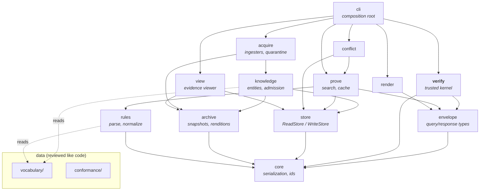
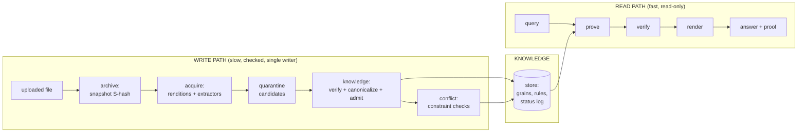

# Codebase layout — the visual architecture

**Problem:** "all codebases line up" needs a picture before the first file exists: which modules
exist, what each may depend on, and where every kind of data lives on disk. This document is
that picture. It is the planned shape; the implementation-language ADR (checklist P1.1) fills in
file extensions, nothing else.

**Why it matters:** the trust properties of Hourglass (tiny verifier, blind renderer, single
writer) are *dependency* properties. If the module graph is right, the compiler enforces the
architecture; if it's wrong, no amount of discipline saves it.

## Repository tree (planned)

```
Hourglass/
├── README.md, CHECKLIST.md, CLAUDE.md
├── docs/                      # this notebook (preservation policy applies)
│
├── vocabulary/                # DATA, not code — reviewed like code
│   ├── relationships/         #   one declaration file per canonical relationship
│   └── constraints/           #   DISJOINT_WITH declarations, functional flags
│
├── conformance/               # executable specs — the fixtures named in docs/Specifications
│   ├── grains-v1.tsv          #   fact → canonical bytes → id          (P1.3)
│   ├── rules-v1/              #   valid + invalid rule fixtures         (P2.2)
│   ├── answers-v1/            #   query → expected response bytes      (P2.10)
│   └── extractors/            #   per-pattern corpora → expected grains (P5.5)
│
├── src/
│   ├── core/                  # canonical serialization, SHA-256 ids, literal normal forms
│   ├── envelope/              # query + response types (answer-envelope.md) — types only
│   ├── verify/                # THE TRUSTED KERNEL: proof checker. Depends on core+envelope only
│   ├── store/                 # ReadStore/WriteStore interface; sqlite/ and memory/ impls;
│   │                          #   status log (hash chain)
│   ├── archive/               # content-addressed snapshot + rendition stores (file-intake.md)
│   ├── knowledge/             # entities, vocabulary loader, canonicalization, admission
│   ├── rules/                 # rule parser, normalizer, declaration-derived generic rules
│   ├── prove/                 # tabled evaluator, proof construction, closures, proof cache
│   ├── conflict/              # constraint checks, dispute lifecycle, conflict records
│   ├── acquire/               # ingesters (tier 1–3), converters/renditions, quarantine
│   ├── render/                # proof → text. Depends on envelope ONLY
│   ├── view/                  # evidence viewer: highlights on originals (evidence-viewer.md);
│   │                          #   read-only leaf — nothing imports it except cli
│   └── cli/                   # curator + query + scan/ingest/show commands; the only
│                              #   composition root
│
├── tests/                     # unit/integration tests beyond the conformance suites
│
└── (runtime data, gitignored) # created by the engine, never committed:
    kb.sqlite                  #   the knowledge store (ADR-0004)
    kb.sqlite-cache            #   proof cache — rebuildable, deletable
    archive/                   #   original uploaded bytes, content-addressed (file-intake.md)
    renditions/                #   derived text/tables — rebuildable, deletable
```

## Module dependency graph

Arrows mean "may depend on." Anything not drawn is forbidden — reviews reject it, and the build
should too (import-lint rule per module).



## The four load-bearing constraints in that graph

1. **`verify` depends on `core` + `envelope` and nothing else.** No store, no prover, no I/O.
   That is the de Bruijn criterion as a build rule
   ([proof-engine.md](../Reasoning/proof-engine.md#verification)) — the trusted kernel stays
   small because it *cannot* grow dependencies.
2. **`render` depends on `envelope` only.** The renderer cannot reach a store handle because no
   import path to one exists ([answer-envelope.md](../Specifications/answer-envelope.md#rendering)).
   "May never introduce information" is enforced by the linker, not by review vigilance.
3. **`prove` gets `ReadStore`; only `knowledge`/`conflict` admission code ever sees
   `WriteStore`**, and `cli` wires exactly one WriteStore instance
   ([storage-interface.md](../Specifications/storage-interface.md#two-handles-not-one)).
4. **`acquire` cannot import `prove`, `verify`, or `render`.** Extraction can propose; it can
   never prove or answer. The untrusted/trusted boundary from
   [parsing.md](../Research/parsing.md#framing-that-changes-the-problem-output-is-candidates)
   is a missing arrow, not a guideline.
5. **`view` is a read-only leaf.** It reads ReadStore + archive to draw evidence highlights
   ([evidence-viewer.md](evidence-viewer.md)); nothing imports it except `cli`, so display can
   never influence proving, admission, or rendering.

## Write path / read path, mapped onto modules



Where things sit at runtime — one table, no exceptions:

| Data | Lives in | Rebuildable? |
|---|---|---|
| Uploaded originals (PDF, XLSX, anything) | `archive/` content-addressed tree | No — this is ground truth ([file-intake.md](file-intake.md)) |
| Derived text/tables/location maps from those files | `renditions/` | Yes — from originals + converter version |
| Grains, entities, rules, provenance, status log | `kb.sqlite` | No — this is the knowledge |
| Proof cache, materialized closures | cache store | Yes — losing it loses nothing |
| Vocabulary + conformance fixtures | git (this repo) | Versioned like code |

Nothing else exists. A file that doesn't fit one of these five rows is a design smell
([requirements-traceability.md](../Specifications/requirements-traceability.md#reverse-check--no-orphan-machinery)).

## Related documents

- Uploaded-file handling in depth: [file-intake.md](file-intake.md)
- Subsystem responsibilities: [overview.md](overview.md)
- Interfaces the modules implement: [Specifications/](../Specifications/README.md)
