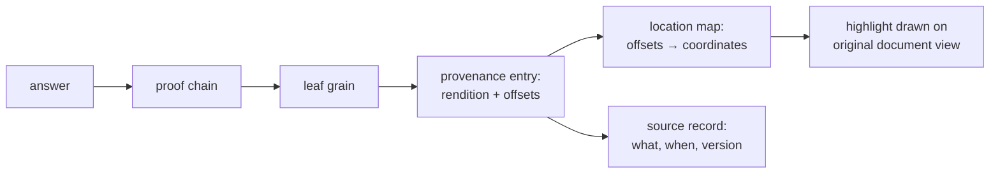

# Evidence viewer: showing the user where information came from

**Problem:** provenance exists as data — every grain carries source ids, excerpts, and offsets
([provenance.md](../Knowledge_Model/provenance.md)). But a human doesn't trust a byte offset;
a human trusts *seeing it*: the original document open in front of them with a colored box
around the exact cell, sentence, or scanned region the fact came from.

**Why it matters:** "can every answer be traced?" (REQ-08) is only half-answered by machine-
readable provenance. The other half is a display a non-engineer can point at and say "there —
that's where it got this." It is also, unchanged, the screen a curator needs to confirm
OCR-derived grains against the page image (checklist P5.12) — **one component, two duties**,
which is the KISS reason this exists as a single subsystem and not two.

## The chain the viewer walks

Every link already exists in the data model; the viewer adds no new truth, it renders the walk:

Concretely: *"Rex has lungs" → grain G4 → excerpt at offsets 120–143 of rendition
`pdftext@2.1` → location map says those characters sit on page 3 in box (x,y,w,h) → draw a
colored rectangle there on the rendered page.*

## Location maps: the one new artifact

A **location map** is a converter output emitted *alongside* each rendition
([file-intake.md](file-intake.md#renditions-the-conversion-layer)): a deterministic table from
rendition offsets to positions in the original document. Same rules as renditions — hashed,
versioned with the converter, rebuildable, never part of the trusted path:

| Format | Location map entries | Highlight looks like |
|---|---|---|
| XLSX / CSV | offset range → (sheet, row, column) | colored cell(s) in a rendered sheet |
| PDF (born-digital) | char range → (page, bounding box) — extractable deterministically from the text layer | colored rectangle on the page image |
| PDF (scanned) / images via OCR | word → bounding box (OCR engines emit these natively) | colored rectangle on the scan — exactly the side-by-side view P5.12 needs |
| DOCX / ODT / HTML | char range → (element path, char offset) | highlighted span in rendered text |
| TXT / Markdown / JSON | char range → (line, column) | highlighted span |

No converter, no location map, no highlight — the viewer degrades honestly to "excerpt +
citation" text, never to a guessed position.

## Presentation (v1)

- **Command:** `hourglass show <grain-id>` — and every rendered answer offers it per leaf grain
  (`--evidence` on a query emits the views for the whole proof).
- **Output: a self-contained generated HTML file** opened locally — document view (page image,
  rendered sheet, or text) with colored highlight overlays, plus a legend: one color per
  source, listing locator, retrieval date, version, and extraction method. Generated output,
  like a rendered answer; **not stored, not served** — this stays inside the "no web UI in v1"
  scope line ([v1-scope.md](../Specifications/v1-scope.md#out--explicitly-not-in-v1)), because
  there is no server, no session, no interactivity beyond what a static file gives.
- **Colors are deterministic:** source index within the view → fixed palette position. Two runs
  produce byte-identical HTML. Even the highlighting obeys the determinism contract — there is
  no reason for any output of this system to be unreproducible.
- **CLI fallback:** the same information as text (excerpt, source citation, cell/page
  reference) for terminal-only use.
- **Multiple sources on one grain** (the corroboration case) render as multiple colored boxes —
  possibly across several documents — which is corroboration made *visible*: three boxes in
  three independent files says more to a human than any number would
  ([provenance.md](../Knowledge_Model/provenance.md#corroboration-not-confidence)).

## Curator duty: the same screen confirms OCR

The P5.12 confirmation flow is this viewer pointed at a quarantined grain: scan image with the
OCR-located box on one side, proposed grain and excerpt on the other; the curator's
confirm/reject is entered through the CLI and lands in the status log like any status change.
No second rendering stack, no separate "admin UI" — the end-user provenance view and the
curator verification view are one codebase path with two entry points.

## Where it sits in the codebase

A new `view/` module ([codebase-layout.md](codebase-layout.md)): depends on `ReadStore` (grain
+ provenance lookups), `archive/` (snapshots, renditions, location maps), and `core`. It may
not import `prove`, `verify`, or `render`, and nothing imports *it* except `cli` — display is a
leaf of the dependency graph, downstream of proof, incapable of influencing an answer. The
viewer shows verified provenance; it never adds interpretation (no auto-summaries of the
surrounding page, no "relevant context" beyond the recorded excerpt — that would be the
renderer-embellishment sin in a new costume).

## Rejected alternatives

- **Writing annotations into the original file** (PDF annotation layers, xlsx cell styling) —
  touches archived bytes, violating the ground-truth invariant
  ([file-intake.md](file-intake.md#the-invariant)). Highlights are overlays generated at view
  time; the original is never modified.
- **A served web application** — out of v1 scope; the static-file approach delivers the "oh
  wow" moment with a fraction of the surface area. Revisit as a v2 RFC if static files chafe.
- **Approximate highlight positioning** (string-search for the excerpt at view time instead of
  location maps) — breaks on repeated text and OCR drift; a *guessed* box under a "here's your
  proof" banner is worse than no box. Location maps are exact or the viewer says so.

## Future work

- Deep links: rendered answers embedding `show` references per sentence.
- Diff view for conflict records: both disputed grains' evidence side by side, colored per
  side — the contradiction engine's conflict record made visual (natural v2 extension of the
  same component).
